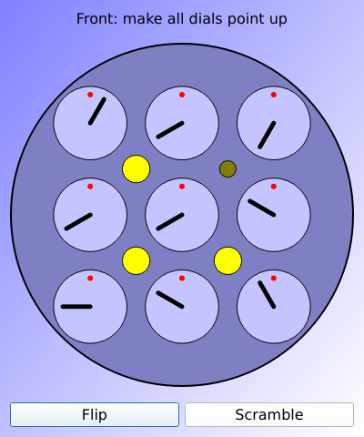
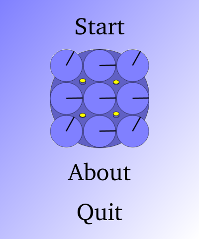

# Rubik's Clock

Rubik's Clock is a simulation of the Rubik's Clock puzzle,
and one of [Richèl Bilderbeek's games](https://richelbilderbeek.github.io/games)

- [Play Rubik's Clock in your browser](play.md)
- [Download the Windows version](https://richelbilderbeek.github.io/RubiksClock/rubiksclock_windows.zip):
  unzip it and run `rubiksclock.exe`

## How to play

The clock has nine dials on each side.
The goal is to make all eighteen dials point up, to 12 o'clock.

Action                                    |Mouse
------------------------------------------|-----------------------------------------
Turn a wheel clockwise                    |Click on a corner dial
Turn a wheel counter-clockwise            |Right-click or Shift-click on a corner dial
Push or pull a peg                        |Click on the peg
Look at the other side                    |Click 'Flip'

Turning a wheel turns its corner dial, and,
depending on which pegs are pushed in, other dials too.
A peg that is pushed in at one side sticks out at the other side.

Press Escape to go back to the menu.

